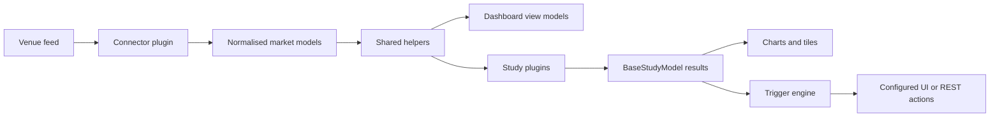

# Architecture overview

VisualHFT turns live venue data into a shared market-data view, analytical studies, and configurable trigger actions. Two desktop hosts run that core: the WPF application on Windows, and the Avalonia application on macOS. This page describes the open-source repository as it runs today.

## System at a glance

## Components and dependency boundaries

### Desktop hosts

The `VisualHFT` project is the WPF application. It starts the Windows application, hosts the WPF dashboard, and owns the WPF settings and trigger-configuration windows.

The `VisualHFT.Desktop` project is the Avalonia application. It starts the macOS application, hosts that dashboard, and edits the same plugin settings models without WPF views. It does not reference WPF.

Both hosts call `PluginManager` to load and start plugins. Neither host owns a private copy of that lifecycle.

### Shared libraries

`VisualHFT.Commons` contains the shared market models, helper publishers, plugin contracts, and plugin base classes. It does not depend on WPF or Avalonia.

`VisualHFT.Runtime` contains plugin discovery, plugin start/stop, and the trigger engine. It references `VisualHFT.Commons` and does not reference either UI stack. Both hosts reference it.

`VisualHFT.Commons.WPF` contains reusable WPF support and depends on `VisualHFT.Commons`. Only the WPF host uses it.

### Plugins

Connector and study assemblies use the shared contracts. A connector derives from `BasePluginDataRetriever`. A study derives from `BasePluginStudy`. Built-in plugins are project references of the host that ships them, so their assemblies are copied beside that host for runtime discovery.

Those projects multi-target `net10.0` and `net10.0-windows`. WPF settings views compile only into the Windows target. On the non-Windows target, `GetUISettings()` returns null and the Avalonia host edits the settings object directly. Existing settings JSON stays compatible: a new field is optional, and a file written by an older build still deserializes.

## Market-data path

A connector receives a venue-specific feed, maps it into VisualHFT's normalised models, and publishes updates through `RaiseOnDataReceived(...)`. Order books, trades, providers, and symbols are delivered by the corresponding shared helper.

Dashboard view models and study plugins subscribe to the same helpers. The helper callbacks are synchronous. A subscriber must copy the fields it needs and return. It must not retain the mutable `OrderBook`, and it must not update UI controls on that call. The Avalonia host stores those copies and paints them from a UI timer.

## Study results and triggers

Studies decide how to process their input. A short calculation can run in a helper callback. A study that needs to keep an order-book state or do longer work can take an `OrderBookSnapshot`, queue that work, and dispose the snapshot when it is finished.

`BasePluginStudy.AddCalculation(...)` sends a `BaseStudyModel` through the study's aggregation and result path, then raises `OnCalculated`. The plugin manager registers a single study under its plugin id. A multi-study child that emits a metric is registered under `parentId|tileTitle`, the same id `GetSelectableStudies()` publishes. The multi-study parent is not registered. Stopping a plugin removes that registration, so a later start does not stack handlers. The dashboard consumes the same study output for live tiles and charts.

This is deliberately not a claim that every study uses a queue or snapshot. For example, the VPIN study processes its configured trade and order-book callbacks directly, while the Market Resilience study snapshots order books before queued processing.

## Plugin discovery and lifecycle

At startup, `PluginManager.LoadPlugins()` scans the base directory of the running host for DLLs. It creates non-abstract exported types that implement `IPlugin`, then starts the applicable connector, study, or multi-study lifecycle. A DLL that is not a managed plugin is skipped. One bad file does not abort the scan. Loading the same plugin type twice does not create a second instance.

For a source build, add an extension project as a `ProjectReference` to the host that should ship it: `VisualHFT.csproj` on Windows, `VisualHFT.Desktop.csproj` on macOS. Its output must be copied next to that host's executable. The two hosts must not share an output directory. Discovery loads assemblies in the host process. It is not a process-isolation boundary.

## Extending VisualHFT

Start from the public templates:

- [Market connector template](../SDK-MarketConnectorTemplate/MarketConnectorSDK_Guidelines.md)
- [Study template](../SDK-StudyTemplate/StudySDK_Guidelines.md)
- [Extension guide](extending/README.md)

## Source map

- [WPF application startup](../App.xaml.cs)
- [Avalonia application startup](../VisualHFT.Desktop/App.axaml.cs)
- [Plugin discovery and lifecycle](../VisualHFT.Runtime/PluginManager/PluginManager.cs)
- [Trigger engine](../VisualHFT.Runtime/TriggerEngine/TriggerEngineService.cs)
- [Avalonia market-data ingress](../VisualHFT.Desktop/Hosting/MarketIngress.cs)
- [Connector publish contract](../VisualHFT.Commons/PluginManager/BasePluginDataRetriever.cs)
- [Study result contract](../VisualHFT.Commons/PluginManager/BasePluginStudy.cs)
- [Order-book callback helper](../VisualHFT.Commons/Helpers/HelperOrderBook.cs)
- [Disposable order-book snapshot](../VisualHFT.Commons/Model/OrderBookSnapshot.cs)

For a visual companion, see the [interactive architecture map](system-architecture.html).
